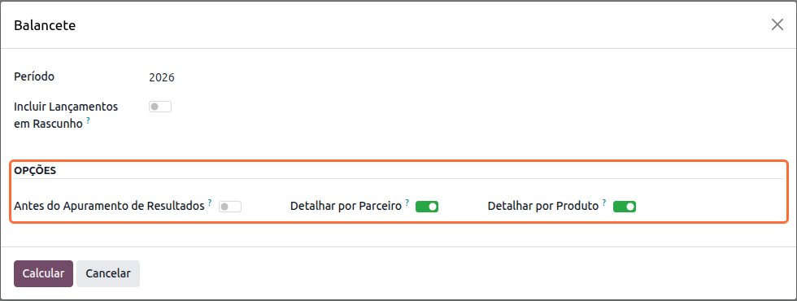
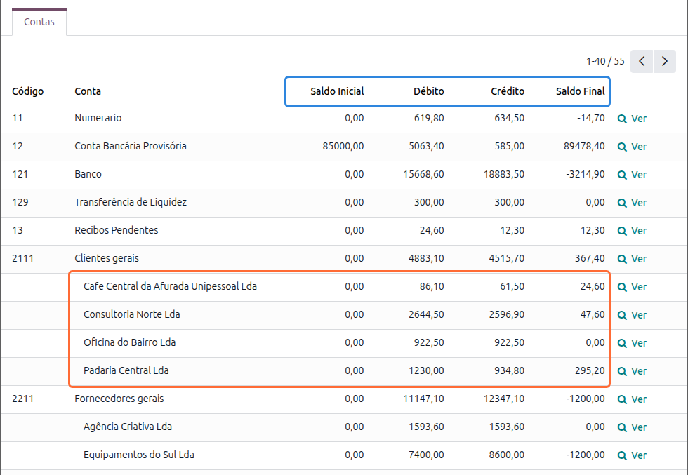

:show-content:

==========================
Relatórios Contabilísticos
==========================
A localização da **Exo Software** acrescenta à app de **Faturação / Contabilidade** os relatórios
contabilísticos usados em Portugal, com consulta no ecrã e exportação para Excel

.. raw:: html

    

        ─── ✦ ───
    

Balancete
=========
O balancete mostra, para cada conta com movimentos, o saldo no início do período, os débitos e os créditos
do período e o saldo no fim do período

Para o obter, aceda à app de **Faturação / Contabilidade** (dependendo respetivamente se tem versão Community
ou Enterprise do Odoo) e vá ao menu :menuselection:`Relatórios --> Portugal --> Financeiros --> Balancete`

Escolha o **Período** (o ano atual ou um dos dois anteriores, o mês atual ou o anterior, ou um intervalo de
datas à sua escolha) e, se quiser contar com os lançamentos que ainda não foram publicados, ative
**Incluir Lançamentos em Rascunho**. No grupo **Opções** pode ainda escolher:

- **Antes do Apuramento de Resultados**: deixa de fora os lançamentos dos diários de apuramento de resultados
  com data no período. Com a opção desligada, o balancete mostra a situação depois do apuramento; ligada, as
  contas de gastos e de rendimentos mostram os saldos do exercício antes de passarem para resultados
- **Detalhar por Parceiro**: abre por parceiro as contas de clientes e de fornecedores
- **Detalhar por Produto**: abre por produto as contas com movimentos de produtos

Clique em **Calcular**. O separador **Contas** lista as contas por código, com as colunas **Saldo Inicial**,
**Débito**, **Crédito** e **Saldo Final**. O saldo inicial reúne todos os movimentos anteriores à data de
início, e o saldo final junta-lhe os débitos e os créditos do período

As contas aparecem agrupadas pelos grupos contabilísticos do plano de contas, da classe até ao último grau,
como no balancete nativo do Odoo. Cada grupo tem uma linha de subtotal a negrito com o saldo inicial, os
débitos, os créditos e o saldo final das contas que reúne, e as contas ficam por baixo do respetivo grupo

Com o detalhe ligado, as linhas de cada parceiro ou produto aparecem por baixo da respetiva conta e somam o
valor da conta. Os movimentos sem parceiro ou sem produto ficam no fim do detalhe, em **Sem Parceiro** ou
**Sem Produto**

A lista termina com uma linha de **Total**, em que o total dos débitos é igual ao total dos créditos. O botão
**Ver** de cada linha abre os movimentos que compõem o respetivo saldo final, e o botão **Exportar XLSX**
gera o balancete em Excel, com as mesmas colunas e linhas

.. note::
    Numa empresa com sucursais, o balancete junta sempre os lançamentos da empresa principal e de todas as
    sucursais
