:nosearch:

================================
Faturação Eletrónica (CIUS-PT)
================================
EDI (*Electronic Data Interchange*) é a troca eletrónica de documentos entre entidades através de
um intermediário — o **broker** — que, além de entregar o documento, certifica o envio e a
receção. A **CIUS-PT** é a especificação portuguesa da norma europeia CIUS para faturas em
ficheiro estruturado (XML), e é o formato usado quando fatura eletronicamente em Portugal.

.. important::
    A obrigatoriedade legal do CIUS-PT aplica-se **apenas à venda a entidades do setor público
    (B2G)**. Entre empresas (B2B) o formato é tecnicamente suportado mas a sua utilização é
    opcional.

Não existe um broker único em Portugal: cada entidade pública escolhe o seu. A Exo tem
integração implementada com a **Saphety** — entretanto adquirida pela Sovos, pelo que a interface
do produto apresenta as duas designações — e com a **Generix**. Para alcançar
destinatários servidos por outro broker, estas contratam diretamente a abertura de
interligação — um valor **por interligação, pagamento único**, não por destinatário nem recorrente. A este acresce a avença do broker, e é
este custo recorrente — não o de implementação — que justifica optar pela via manual descrita
mais abaixo para um volume esporádico de faturas B2G.

.. note::
    A negociação e o pagamento destes valores são matéria entre a sua empresa e a Saphety;
    valores indicativos, alteráveis unilateralmente pela Saphety.

A solução é composta por quatro módulos, com um único fluxo: a base gera e valida o ficheiro
CIUS-PT; o de broker (Saphety ou Generix) acrescenta-lhe a transmissão ao broker; o de vendas
acrescenta captura a montante, na encomenda.

.. list-table::
   :header-rows: 1

   * - Módulo
     - O que acrescenta
     - Depende de
   * - **Portugal - E-invoicing CIUS-PT**
     - Geração e validação do ficheiro CIUS-PT na fatura e nota de crédito. Funciona sozinho.
     - —
   * - **Portugal - Saphety EDI**
     - Transmissão ao broker, no envio da fatura, e acompanhamento do estado de entrega.
     - E-invoicing CIUS-PT
   * - **Portugal - Generix EDI**
     - Transmissão à Generix, no envio da fatura, e acompanhamento do estado de entrega.
     - E-invoicing CIUS-PT
   * - **Portugal - Sales B2G and EDI**
     - Campos B2G na encomenda de venda, com propagação para a fatura.
     - E-invoicing CIUS-PT e Vendas PT+

Os quatro módulos fazem parte da sua subscrição **PT+** e não exigem pedido à Exo Software:
ativam-se diretamente nas definições, tal como qualquer outra funcionalidade da localização.

.. warning::
    A comunicação em CIUS-PT cobre exclusivamente **faturas e notas de crédito**, e apenas no
    **sentido da venda**. Guias de remessa, encomendas a fornecedores, receção de documentos e o
    intercâmbio típico do retalho B2B não estão cobertos por esta solução. Se precisar de um
    destes cenários, contacte a **Exo Software** para avaliação em sede de implementação.

.. raw:: html

    

        ─── ✦ ───
    

Configurações
==================

Ativação dos módulos
-------------------------
Aceda à app **Faturação / Contabilidade** (dependendo respetivamente se tem versão Community ou
Enterprise do Odoo), vá ao menu :menuselection:`Configuração --> Configurações` e na secção
**Portugal** ative a opção :guilabel:`Faturação Eletrónica`. Se pretender transmitir as faturas
via Saphety, ative também a opção :guilabel:`Broker EDI Saphety`; via Generix, a opção
:guilabel:`Generix EDI broker`. Ambas ficam disponíveis na mesma secção assim que a opção
anterior está ativa.

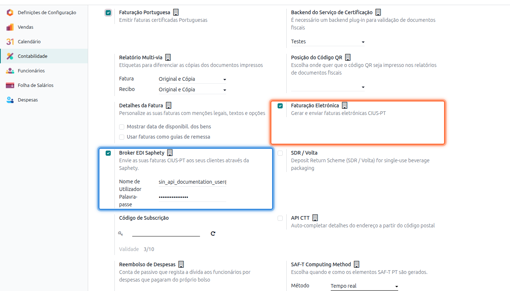

.. note::
    Cada uma destas opções instala o respetivo módulo. A **Portugal - Sales B2G and EDI** não
    aparece aqui — instala-se sozinha assim que a E-invoicing CIUS-PT e as Vendas PT+ estão
    presentes.

.. tip::
    A secção Portugal expõe ainda a opção :guilabel:`Desativar Validação do Esquema`, apenas em
    modo de programador e apenas com o backend de certificação em modo **Testes**. Serve para
    publicar faturas apesar de a validação do ficheiro CIUS-PT falhar — não recomendado fora de um
    ambiente de testes.

Credenciais do broker
------------------------
Com a opção **Broker EDI Saphety** ativa, preencha o :guilabel:`Nome de Utilizador` e a
:guilabel:`Palavra-passe` da conta Saphety da sua empresa, na mesma secção Portugal das
definições — campos assinalados a azul na imagem acima — e guarde.

Com a opção **Generix EDI broker** ativa, o procedimento é o mesmo: preencha o
:guilabel:`Username` e a :guilabel:`Password` da conta Generix da sua empresa, logo abaixo da
opção, e guarde.

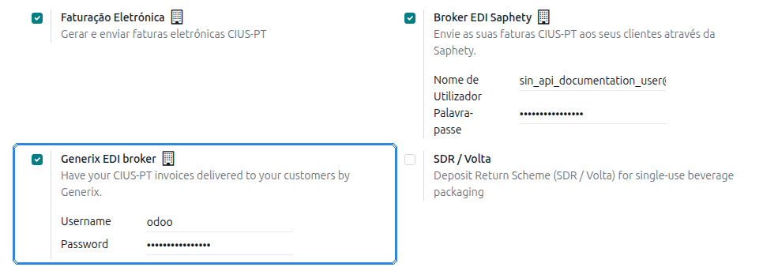

Ações agendadas
------------------
A transmissão ao broker e o acompanhamento do estado usam duas ações agendadas. Para as ver,
ative o modo de programador e abra
:menuselection:`Definições --> Técnico --> Automação --> Ações Agendadas`.

.. image:: e-invoicing/v18_edi_crons_list.png
   :align: center

.. list-table::
   :header-rows: 1
   :widths: 30 45 25

   * - Ação agendada
     - O que faz
     - Execução por omissão
   * - **PT EDI: Enviar faturas eletrónicas agendadas**
     - Transmite ao broker as faturas eletrónicas que aguardam o envio agendado. Só tem efeito
       com a opção `Envio agendado`_ ativa.
     - Uma vez por dia, à noite (21h00 UTC).
   * - **EDI : Realizar operações de serviços web**
     - Consulta o broker e atualiza o estado dos documentos enviados. Consulte
       `Atualização do estado dos documentos`_.
     - Uma vez por dia.

.. note::
    O Odoo instala a ação **EDI : Realizar operações de serviços web** desativada. A instalação
    da **Saphety EDI** ou da **Generix EDI** ativa-a. Se o estado dos documentos não muda,
    confirme que a ação tem o campo :guilabel:`Ativo` ligado.

Envio agendado
-----------------
Por omissão, o Odoo transmite a fatura eletrónica ao broker quando envia a fatura. Para
transmitir todas as faturas eletrónicas de uma vez, a uma hora fixa, ative o envio agendado:

#. Em :menuselection:`Configuração --> Configurações`, secção **Portugal**, marque a opção
   :guilabel:`Envio Agendado de Faturas Eletrónicas`, por baixo de
   :guilabel:`Faturação Eletrónica`.
#. Clique em :guilabel:`Guardar`.
#. Clique em :guilabel:`Definir a hora de envio`. O Odoo abre a ação agendada
   **PT EDI: Enviar faturas eletrónicas agendadas**.

.. image:: e-invoicing/v18_edi_scheduled_sending_settings.png
   :align: center

Na ação agendada, defina quando o Odoo envia as faturas:

#. No campo :guilabel:`Próxima Data de Execução`, defina o dia e a hora do próximo envio.
#. No campo :guilabel:`Executar a Cada`, defina o intervalo entre dois envios.
#. Guarde.

.. image:: e-invoicing/v18_edi_scheduled_sending_cron.png
   :align: center

.. note::
    A opção é definida por empresa. A ação agendada é comum a todas as empresas da base de
    dados: a hora de envio é a mesma para todas.

.. tip::
    Para enviar de imediato as faturas que aguardam, abra a ação agendada e clique em
    :guilabel:`Executar Manualmente`.

Formato do parceiro e herança
-------------------------------
Indique, na ficha de cada parceiro cliente, que este deve receber faturas em CIUS-PT. Abra a
ficha do parceiro, separador :guilabel:`Contabilidade`, e na secção **Faturas a Clientes** defina
o campo :guilabel:`Formato da fatura eletrónica` como :guilabel:`Portugal (CIUS-PT)`.

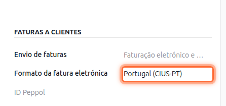

.. note::
    O campo só é visível em modo de programador. Para o ativar, clique no ícone de inseto no
    canto superior direito ou adicione ``?debug=1`` ao endereço da página.

.. important::
    Esta definição faz-se no **parceiro principal** e é herdada automaticamente por todos os seus
    contactos filhos — não precisa de a repetir por delegação, departamento ou morada de entrega.
    Para um contacto individual associado a uma empresa esta herança não é sequer visível na
    interface: o Odoo esconde o separador de faturação nesse caso, por não ser normalmente esse
    contacto a ser faturado. A definição no parceiro principal é o suficiente e aplica-se de forma
    transparente sempre que um documento é emitido para qualquer um dos seus contactos.

GLN do cliente e do local de entrega (Generix)
--------------------------------------------------
Alguns clientes com várias lojas, por exemplo cadeias de retalho, identificam cada loja e cada
local de entrega pelo seu GLN (*Global Location Number*). Com a **Generix EDI** instalada, o
campo :guilabel:`GLN` fica visível em todos os contactos:

#. Abra a ficha do contacto: a loja que usa como cliente nas faturas, ou a morada de entrega.
#. No separador :guilabel:`Vendas e Compras`, secção **Diversos**, preencha o campo
   :guilabel:`GLN`.
#. Guarde a ficha.

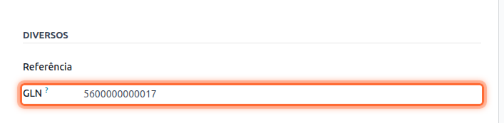

O campo também aparece no formulário de cada contacto, no separador
:guilabel:`Endereços e contactos` da ficha do parceiro principal.

O ficheiro CIUS-PT usa o GLN de dois contactos da fatura:

.. list-table::
   :header-rows: 1
   :widths: 30 70

   * - Contacto da fatura
     - O que o GLN identifica no ficheiro CIUS-PT
   * - **Cliente**
     - O comprador. Sem GLN, o ficheiro identifica o comprador pela :guilabel:`Referência` do
       parceiro principal.
   * - **Morada de entrega**
     - O local de entrega.

Se a fatura não tiver morada de entrega, o Odoo usa o cliente como local de entrega. Nesse caso,
o mesmo GLN identifica o comprador e o local de entrega.

.. important::
    Ao contrário do formato da fatura eletrónica, o GLN **não é herdado** do parceiro principal.
    Preencha-o em cada contacto que usa nas faturas, como cliente ou como morada de entrega. O GLN
    do parceiro principal só é usado nas faturas emitidas ao próprio parceiro principal.

Preços líquidos nas faturas eletrónicas (Generix)
----------------------------------------------------
Por omissão, cada linha do ficheiro CIUS-PT tem o preço unitário sem desconto e o desconto da
linha em separado. A plataforma de alguns clientes não aceita descontos. Para esses clientes,
envie o preço unitário com o desconto já deduzido. Com a **Generix EDI** instalada:

#. Abra a ficha do parceiro principal do cliente.
#. No separador :guilabel:`Contabilidade`, secção **Faturas a Clientes**, marque a opção
   :guilabel:`Preços Líquidos nas Faturas Eletrónicas`.
#. Guarde a ficha.

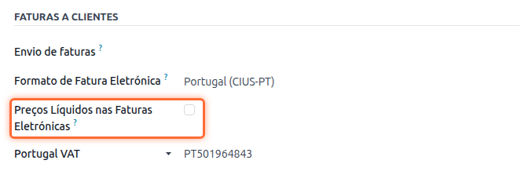

A opção só aparece quando o :guilabel:`Formato de Fatura Eletrónica` do parceiro é
:guilabel:`Portugal (CIUS-PT)`. Consulte `Formato do parceiro e herança`_.

Com a opção marcada, as linhas do ficheiro CIUS-PT mudam assim:

.. list-table::
   :header-rows: 1
   :widths: 40 30 30

   * - Linha da fatura: 2 unidades a 100,00 € com 10% de desconto
     - Sem a opção
     - Com a opção
   * - **Preço unitário**
     - 100,00 €
     - 90,00 €
   * - **Desconto da linha**
     - 20,00 €
     - —
   * - **Total da linha**
     - 180,00 €
     - 180,00 €

O total da linha e o total da fatura não mudam. A opção só muda o ficheiro CIUS-PT: a fatura no
Odoo e o PDF continuam a mostrar o preço unitário e o desconto.

.. note::
    O Odoo lê a opção no parceiro principal. A opção aplica-se às faturas emitidas a todos os
    seus contactos.

Verificação prévia do destinatário
--------------------------------------
Antes de faturar, confirme que o NIF do parceiro está registado na plataforma Saphety: na ficha
do parceiro, ao lado do campo :guilabel:`NIF`, o botão :guilabel:`Check Sovos/Saphety` consulta a
plataforma e mostra o resultado — verde se o parceiro está apto a receber faturas via Saphety,
vermelho caso contrário.

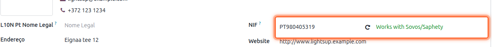

Se usar a Generix, a verificação é a mesma, através do botão :guilabel:`Check Generix`, no mesmo
sítio. A consulta só é feita quando o campo :guilabel:`Envio de faturas` do parceiro está definido
como :guilabel:`pela Generix` e as credenciais Generix estão preenchidas nas definições.

.. important::
    Trate esta verificação como **pré-condição do fluxo**, não como funcionalidade acessória: um
    NIF não registado no broker (Saphety ou Generix) impede a entrega mesmo com o ficheiro
    CIUS-PT correto.

Utilização
==================
O fluxo é único; as variações introduzidas por cada módulo estão assinaladas nos pontos em que
divergem.

Publicação e validação
--------------------------
O CIUS-PT impõe regras de conteúdo além das regras legais da fatura. Essa validação corre na
**publicação**: se falhar, a fatura **não é publicada** e os erros detetados são apresentados
para correção.

.. important::
    Este comportamento é deliberado e evita ter de anular e reemitir faturas já publicadas: a
    contrapartida é um ligeiro aumento do tempo de publicação, não uma limitação do sistema.

O ficheiro XML CIUS-PT é gerado nesse mesmo momento — não no envio — e a sua representação visual
é incluída no PDF da fatura, pelo que **não precisa de transmitir o PDF em separado**.

Via manual, sem broker
--------------------------
Sem o módulo de broker instalado, ou para um volume esporádico que não justifique a avença
descrita no início desta página, descarregue o ficheiro CIUS-PT e submeta-o você mesmo no portal
da Saphety — serviço normalmente prestado sem custo para submissão avulsa.

O ficheiro fica disponível nos anexos da fatura publicada, no painel **Ficheiros** do registo de
atividade (ícone de clip no canto superior direito):

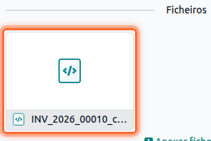

Descarregue-o a partir daí e submeta-o no portal do broker escolhido.

Via broker (Saphety ou Generix)
-----------------------------------
Com a **Saphety EDI** ou a **Generix EDI** instalada e configurada, a publicação da fatura
**não** transmite o ficheiro CIUS-PT ao broker. A transmissão só acontece quando envia a fatura:

#. Abra a fatura publicada e clique em :guilabel:`Enviar`.
#. Na janela de envio, selecione :guilabel:`pela Saphety` ou :guilabel:`pela Generix`.
#. Clique em :guilabel:`Enviar` para confirmar.

.. image:: e-invoicing/v19_edi_send_wizard_generix.png
   :align: center

Se não selecionar uma destas opções, o Odoo não envia o ficheiro ao broker. Com o
`Envio agendado`_ ativo, o Odoo transmite o ficheiro mais tarde, na hora definida.

.. tip::
    Defina o campo :guilabel:`Envio de faturas` do parceiro como :guilabel:`pela Saphety` ou
    :guilabel:`pela Generix`. Assim, a janela de envio mostra essa opção já selecionada para as
    faturas desse parceiro.

Com o envio agendado ativo
~~~~~~~~~~~~~~~~~~~~~~~~~~~~~~
Com a opção :guilabel:`Envio Agendado de Faturas Eletrónicas` ativa, o botão :guilabel:`Enviar`
não transmite o ficheiro CIUS-PT. A fatura fica a aguardar pela ação agendada
**PT EDI: Enviar faturas eletrónicas agendadas**:

- No topo da fatura, o Odoo mostra a mensagem *Esta fatura eletrónica será enviada pela Saphety
  na próxima execução do envio agendado* (ou *pela Generix*).
- Na lista de faturas, o filtro :guilabel:`Fatura eletrónica agendada` mostra todas as faturas
  que aguardam.
- Não pode enviar outra vez uma fatura que aguarda. Se tentar, o Odoo mostra o erro *O CIUS-PT
  já está agendado para envio e não pode ser enviado novamente*.

Na hora definida, a ação agendada transmite as faturas por ordem de data e de número. A ação só
transmite faturas publicadas: uma fatura anulada antes dessa hora não é transmitida.

Se a transmissão de uma fatura falha (por exemplo, o broker não responde), as outras faturas
são transmitidas na mesma. A fatura com falha continua a aguardar e a ação tenta outra vez na
execução seguinte. O motivo da falha fica no histórico da fatura, com a mensagem *O envio
agendado da fatura eletrónica falhou e será tentado novamente na próxima execução*.

Atualização do estado dos documentos
~~~~~~~~~~~~~~~~~~~~~~~~~~~~~~~~~~~~~~
Depois da transmissão, o broker processa o documento de forma **assíncrona**. Não espere ver o
estado final logo após o envio: é o comportamento esperado, não uma falha.

A ação agendada **EDI : Realizar operações de serviços web** consulta o broker e atualiza o
estado. Em cada execução, para cada documento com o estado da submissão *Em Espera* ou
*Em Curso*:

#. A ação consulta o estado do pedido de entrega e atualiza a coluna do estado da submissão.
#. Quando o broker devolve o identificador do documento, a ação consulta também o estado do
   documento na plataforma do broker (por exemplo, *Received*).
#. Quando o broker devolve erros, a ação mostra-os na fatura, no separador
   :guilabel:`Documentos EDI`.

Quando o estado da submissão passa a *Concluído* ou *Erro*, a ação deixa de consultar esse
documento.

.. tip::
    Por omissão, a ação corre uma vez por dia. Uma fatura transmitida à noite pelo envio
    agendado só mostra o estado novo na execução seguinte desta ação. Para atualizar os estados
    mais vezes, diminua o intervalo no campo :guilabel:`Executar a Cada` da ação (por exemplo,
    1 hora). Para atualizar de imediato, clique em :guilabel:`Executar Manualmente`.

Estados na fatura
~~~~~~~~~~~~~~~~~~~~
Depois de a fatura ser transmitida ao broker, o separador
:guilabel:`Documentos EDI` da fatura mostra o estado do documento CIUS-PT:

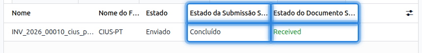

.. list-table::
   :header-rows: 1
   :widths: 30 70

   * - Coluna
     - Descrição
   * - **Estado**
     - Estado do próprio ficheiro CIUS-PT (por exemplo, *Enviado*).
   * - **Estado da Submissão Saphety**
     - Estado do pedido de entrega junto da Saphety: *Em Espera*, *Em Curso*, *Erro* ou
       *Concluído*.
   * - **Estado do Documento Saphety**
     - Estado devolvido pela própria plataforma Saphety (por exemplo, *Received*) — texto
       apresentado tal como a Saphety o devolve, sem tradução.

Com a Generix, a lógica é a mesma e as colunas equivalentes são **Generix Request Status**
(*Queued*, *Running*, *Error* ou *Finished*) e **Generix Document Status** (por exemplo,
*Received*).

.. tip::
    Se a coluna **Estado da Submissão Saphety** (ou **Generix Request Status**) indicar *Erro*,
    verifique o NIF do parceiro e as credenciais do broker nas definições, e reenvie a fatura.

Campos para faturação a entidades públicas (B2G)
----------------------------------------------------
Os campos :guilabel:`Nº do Compromisso` e :guilabel:`Nº do Cabimento`, exigidos na contratação
pública portuguesa, existem na fatura com a app base instalada e podem ser preenchidos
manualmente no separador :guilabel:`Outra Informação`.

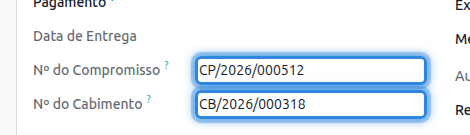

Com o módulo **Portugal - Sales B2G and EDI** instalado, estes mesmos campos ficam também
disponíveis na **encomenda de venda**, no separador :guilabel:`Outra Informação`, secção
**Faturação**:

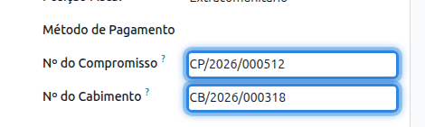

.. tip::
    Os campos só aparecem em encomendas às quais já esteja associado um Tipo de Documento Fiscal
    português (**Série Documental**) — antes disso o Odoo não trata a encomenda como um documento
    fiscal PT e os campos ficam ocultos.

Ao criar a fatura a partir dessa encomenda, os valores propagam-se automaticamente e ficam
igualmente visíveis no separador :guilabel:`Outra Informação` da fatura. Quando preenchidos, são
incluídos no XML CIUS-PT e impressos no PDF de ambos os documentos, encomenda e fatura:

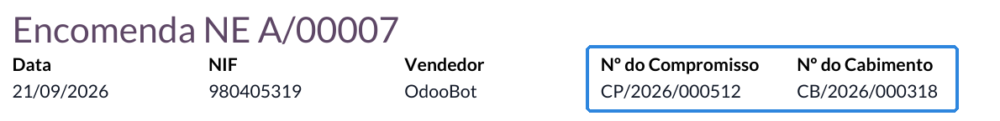

Acompanhamento e resolução de erros
======================================

Conformidade não garante aceitação
--------------------------------------
Uma fatura conforme ao CIUS-PT pode ser aceite pelo broker e ainda assim recusada pelo
destinatário, porque entidades públicas impõem por vezes regras próprias além do formato — por
exemplo, algumas exigem referências Multibanco, que o CIUS-PT prevê mas não torna obrigatórias.

.. important::
    Este é o cenário de erro mais provável em produção: a fatura fica publicada, transmitida com
    sucesso, e é recusada pelo destinatário dias depois. Quando isso acontece, a fatura emitida
    **não é corrigível** — tem de ser anulada, duplicada e reemitida com a correção necessária.

Erros de submissão
----------------------
Um erro no estado de submissão (coluna **Estado da Submissão Saphety** ou **Generix Request
Status** a *Erro*) remete quase sempre para o NIF do parceiro ou para as credenciais do broker na
empresa. Confirme ambos — usando o botão :guilabel:`Check Sovos/Saphety` ou
:guilabel:`Check Generix` na ficha do parceiro — e reenvie a fatura.

.. seealso::
    :doc:`Consulte as nossas FAQs sobre Faturação eletrónica <../faq/e-invoicing_errors>`
