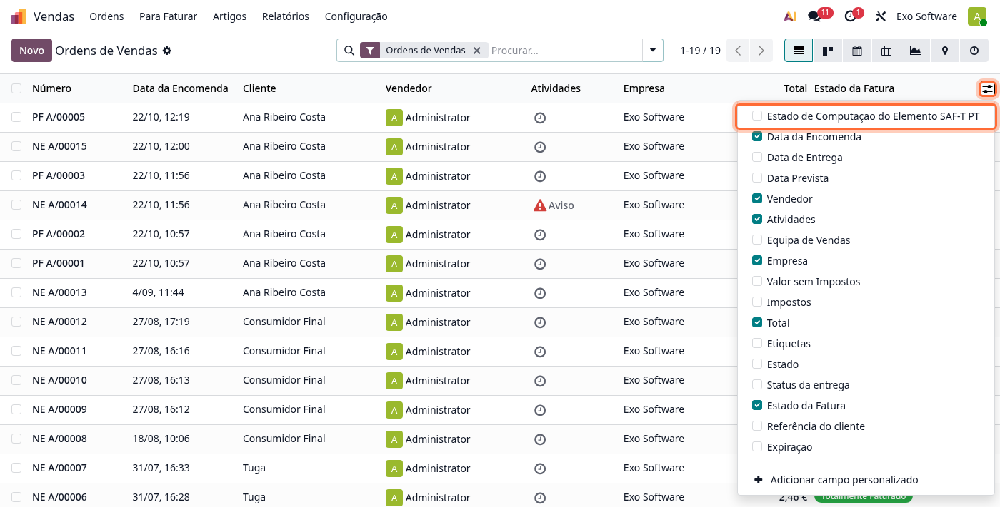
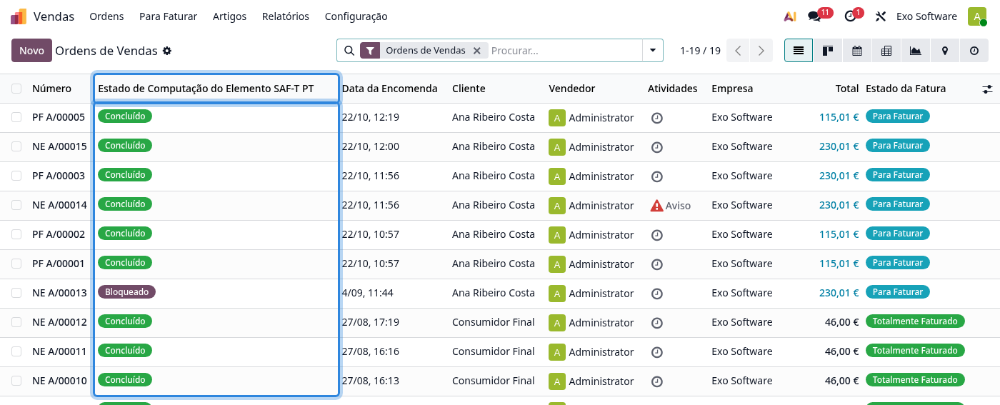
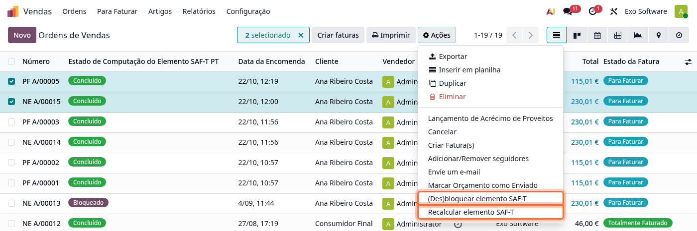
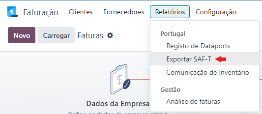
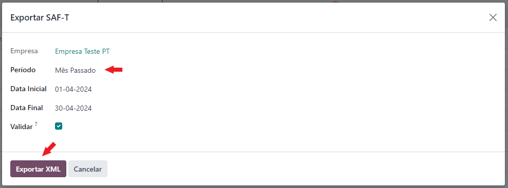
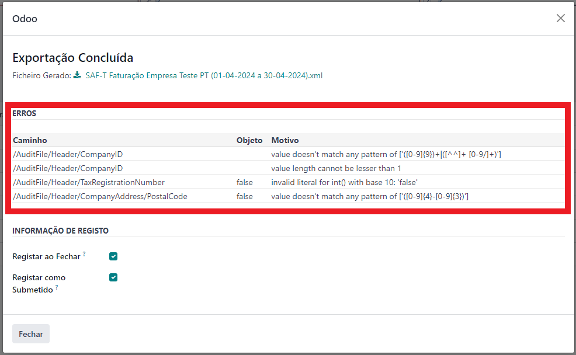
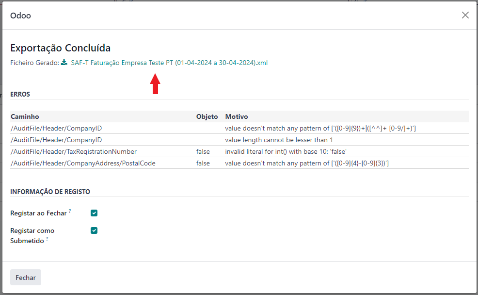
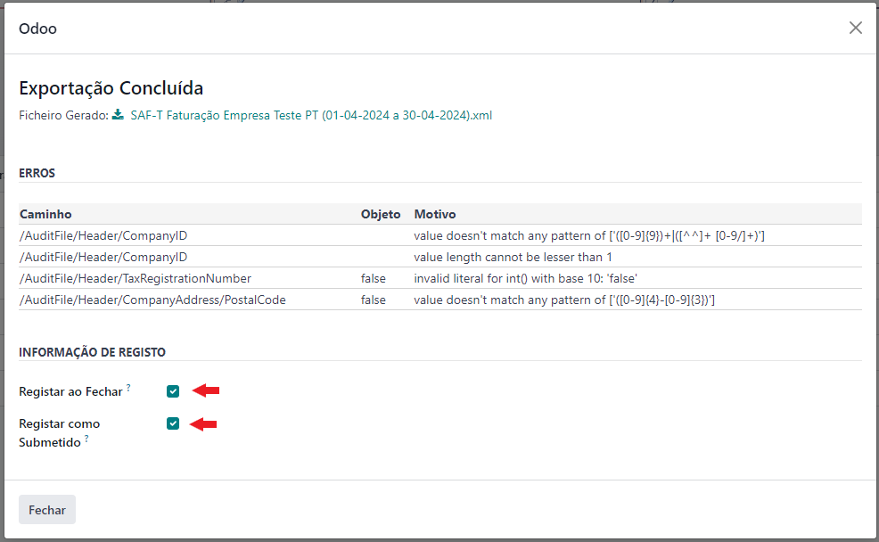

:show-content:

===============
SAF-T Faturação
===============
O SAF-T de faturação é uma obrigação legal que tem de ser cumprida junto da AT

Aprenda o que é o elemento SAF-T de cada documento e como consultar o seu estado, e depois como gerar o ficheiro e lidar
com alguns erros de validação que possam surgir durante a sua criação

.. raw:: html

    

        ─── ✦ ───
    

.. _invoice_saft_element:

Elemento SAF-T
==============
O ficheiro SAF-T é composto por um bloco de informação por cada documento: fatura, recibo, encomenda, guia de
transporte, etc. A esse bloco chamamos **Elemento SAF-T**

Para que a exportação do ficheiro seja rápida, a **Localização PT+** não espera pelo fim do mês para preparar estes
blocos. O elemento de cada documento é preparado e validado logo que o documento é emitido e fica guardado no próprio
documento. Na exportação, o ficheiro SAF-T junta os elementos já preparados

Se mais tarde alterar um documento já emitido de uma forma que afete o SAF-T, o elemento desse documento fica marcado
para ser preparado de novo

Estados do elemento
-------------------
Cada documento mostra em que estado está o seu elemento SAF-T:

.. list-table::
   :header-rows: 1

   * - Estado
     - Significado
   * - **Necessário**
     - O elemento ainda não foi preparado, ou tem de ser preparado de novo. É preparado na próxima exportação do SAF-T
   * - **Concluído**
     - O elemento está preparado e validado, pronto para entrar no ficheiro SAF-T
   * - **Erro**
     - Não foi possível preparar o elemento. O Odoo tenta de novo na próxima exportação do SAF-T, mas deve corrigir o
       documento antes disso
   * - **Bloqueado**
     - O elemento foi congelado manualmente. Entra no ficheiro SAF-T tal como está e nunca é preparado de novo,
       mesmo que o documento seja alterado
   * - **Manual**
     - O elemento foi inserido manualmente pelos nossos serviços

Consultar o estado
------------------
O estado do elemento SAF-T está disponível como coluna opcional nas listas de:

- Faturas, notas de crédito e notas de débito
- Pagamentos
- Encomendas e orçamentos de venda
- Guias de transporte
- Pedidos do Ponto de Venda (restaurante)

A coluna está escondida por defeito. Para a mostrar, abra a lista que quer consultar, carregue no ícone de colunas
opcionais, no canto superior direito da lista, e marque a opção **Estado de Computação do Elemento SAF-T PT**

A coluna passa a mostrar o estado do elemento de cada documento

.. tip::
    O Odoo guarda esta escolha no seu navegador. Só precisa de ativar a coluna uma vez em cada lista

    .. image:: saft_invoicing/v19_saftElement_invoiceColumn.png
       :align: center

Bloquear, desbloquear e recalcular
----------------------------------
Nas mesmas listas, selecione um ou mais documentos e abra o menu **Ações**. Tem duas ações disponíveis:

- **(Des)bloquear elemento SAF-T**, bloqueia os documentos selecionados ou, se já estiverem bloqueados, desbloqueia-os.
  Um documento desbloqueado fica no estado **Necessário**
- **Recalcular elemento SAF-T**, prepara de novo e na hora o elemento dos documentos selecionados. Os documentos
  bloqueados não são recalculados

.. important::
    Para usar a ação **(Des)bloquear elemento SAF-T**, selecione só documentos bloqueados ou só documentos não
    bloqueados. Se misturar os dois, o Odoo mostra um erro

.. warning::
    Bloqueie um elemento apenas quando o pretende manter exatamente como está, por exemplo depois de os nossos
    serviços o corrigirem. Um elemento bloqueado não acompanha as alterações do documento

Exportação
==========
Para poder exportar o ficheiro SAF-T de Faturação que tem de submeter à Autoridade Tributária, aceda à app
**Faturação / Contabilidade** (dependendo respetivamente se tem versão Community ou Enterprise do Odoo), vá ao menu
**Relatórios** e no separador **Portugal** selecione a opção **Exportar SAF-T**.

Vai abrir uma janela que predefine o **Período** como Mês Passado, mas pode selecionar o período como lhe for mais
conveniente, mudando o **Período** ou alterando a **Data Inicial** e/ou **Data Final**.

É recomendado que mantenha o visto na opção **Validar** para fazer uma verificação do ficheiro, no entanto se espera que
o ficheiro seja muito grande pode optar por não fazer esta verificação.

Carregue em **Exportar XML**.

.. note::
    Caso tenha os nossos módulos de contabilidade instalados, terá um campo extra para selecionar o tipo de SAF-T
    escolha a opção **Faturação**

    .. image:: saft_invoicing/v17_exportSAFT6.png
        :align: center

Vai ser gerada uma nova janela com um resumo de possíveis erros que existam nos documentos para que seja mais fácil ver
necessidade de correção de erros

No campo **Motivo** pode encontrar uma descrição do que está a causar o erro

Depois de não ter erros, faça download do ficheiro gerado para inserir no site da Autoridade Tributária.

Esta janela tem ainda duas opções:

   - **Registar ao Fechar**, Vai criar uma entrada junto com uma cópia do ficheiro gerado para que possa consultar posteriormente
   - **Registar como Submetido**, se o visto estiver ativo o registo gerado vai ser considerado como submetido sem problemas à AT

Submeta o ficheiro à AT, depois de submeter o ficheiro pode fechar esta janela.

.. seealso::
    :doc:`Consulte as nossas FAQs sobre SAF-T de Faturação <../faq/saft_errors>`

.. _invoice_saft_invoice_cron:

Automatismo (Cron)
==================
A nossa **Localização PT+** possuí uma ferramenta excepcional para emissão automática dos ficheiros SAFT

Esse automatismo carece de configuração específica às suas necessidades, pelo que pode solicitar os nossos serviços
para o ajudar com as configurações. No entanto uma vez configurado não terá de se preocupar mais.

.. seealso::
    Saiba mais sobre o nosso automatismo de criação de SAF-T marcando uma `Formação <https://exosoftware.pt/en/appointment>`_

..
    Importação
    ==========
    .. TODO : Ainda não existe a ferramenta mas está no roadmap
