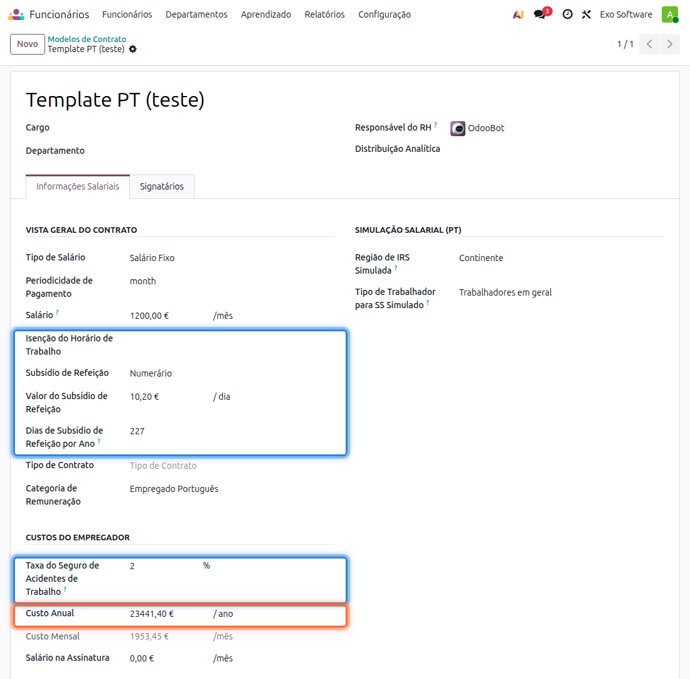
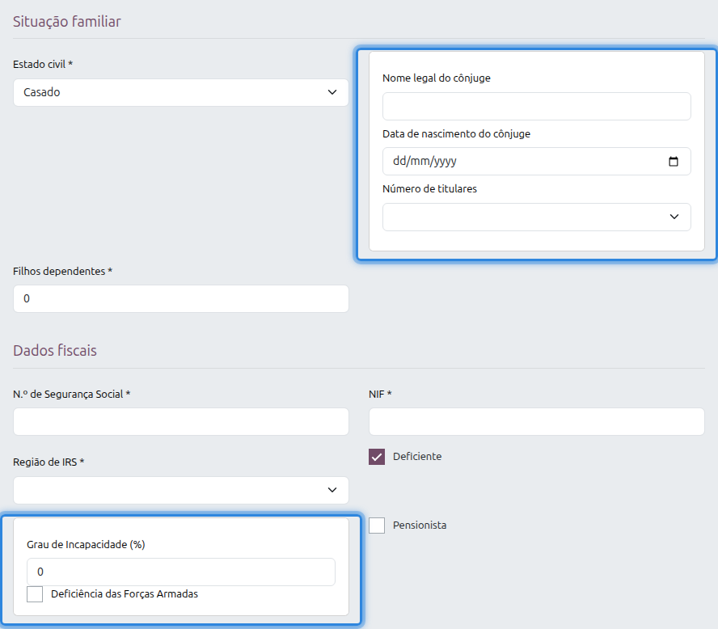

:show-content:

=======================
Configurador de Salário
=======================
O **Configurador de Salário** do Odoo envia a um candidato ou a um funcionário uma oferta com o
pacote salarial, que ele revê e completa com os seus dados pessoais através de um link. Com a
localização portuguesa, o formulário pede os dados de que o processamento salarial português
precisa, e o custo anual para a empresa passa a incluir os encargos portugueses: Segurança Social,
seguro de acidentes de trabalho, isenção de horário e subsídio de refeição.

.. note::
    Estas funcionalidades ficam disponíveis automaticamente quando a Folha de Salários portuguesa e
    o Configurador de Salário do Odoo estão instalados.

.. raw:: html

    

        ─── ✦ ───
    

Modelo de contrato
==================
Os valores que entram no custo para a empresa definem-se no modelo de contrato, em
:menuselection:`Funcionários --> Configuração --> Modelos de Contrato`, no separador
**Informações Salariais**. Uma oferta gerada a partir do modelo recebe estes valores.

.. list-table::
   :header-rows: 1
   :widths: 30 70

   * - Campo
     - Descrição
   * - **Isenção do Horário de Trabalho**
     - Por taxa (percentagem sobre o salário) ou por valor (montante mensal).
   * - **Subsídio de Refeição**
     - Forma de pagamento do subsídio de refeição.
   * - **Valor do Subsídio de Refeição**
     - Valor por dia. Um modelo novo começa com o valor por omissão definido nas definições da
       Folha de Salários para a forma de pagamento escolhida.
   * - **Dias de Subsídio de Refeição por Ano**
     - Dias em que o subsídio é pago ao longo do ano. Por omissão são 227, um ano a tempo inteiro
       sem fins de semana, feriados e os 22 dias de férias.
   * - **Taxa do Seguro de Acidentes de Trabalho**
     - Taxa do seguro, aplicada ao salário e à isenção de horário, nunca ao subsídio de refeição.
   * - **Custo Anual**
     - Custo total do funcionário para a empresa num ano, calculado a partir dos campos acima.

Como é calculado o custo anual
==============================
Para um contrato com pagamento mensal:

- o salário conta 14 vezes, os 12 meses mais os subsídios de férias e de Natal;
- sobre o salário acrescem a taxa contributiva da entidade empregadora para a Segurança Social e a
  taxa do seguro de acidentes de trabalho;
- a isenção de horário por taxa aumenta o salário nessa percentagem; por valor, soma esse montante
  ao salário, com os mesmos encargos;
- o subsídio de refeição soma o valor por dia multiplicado pelos dias por ano, sem Segurança Social
  nem seguro.

A taxa da Segurança Social é a do tipo de trabalhador do funcionário ou, enquanto se trata de um
candidato, a do **Tipo de Trabalhador para SS Simulado** do modelo.

.. tip::
    Com um salário de 1 200 €, Segurança Social a 23,75 %, seguro a 2 % e subsídio de refeição de
    10,20 € por dia:

    - salário com encargos: 1 200 € × 14 × (1 + 23,75 % + 2 %) = 21 126,00 €
    - subsídio de refeição: 10,20 € × 227 = 2 315,40 €
    - **Custo Anual**: 23 441,40 €

O cálculo também funciona no sentido inverso: ao alterar o **Custo Anual**, o Odoo recalcula o
salário a partir dele, com os mesmos encargos.

Formulário da oferta
====================
Quando o candidato ou o funcionário abre o link da oferta, a secção
**As Suas Informações Pessoais** inclui, nos contratos com a estrutura **Empregado Português**,
duas secções próprias:

.. list-table::
   :header-rows: 1
   :widths: 25 75

   * - Secção
     - Campos
   * - **Situação familiar**
     - **Estado civil** e **Filhos dependentes**. Com o estado civil **Casado** ou
       **União de facto**, aparecem também **Nome legal do cônjuge**,
       **Data de nascimento do cônjuge** e **Número de titulares**.
   * - **Dados fiscais**
     - **N.º de Segurança Social**, **NIF**, **Região de IRS**, **Deficiente** e
       **Pensionista**. Com **Deficiente** marcado, aparecem também
       **Grau de Incapacidade (%)** e **Deficiência das Forças Armadas**.

O grau de incapacidade é pedido em percentagem, por exemplo 60, e aparece com esse valor na ficha
do funcionário. Numa oferta a um funcionário que já existe, o formulário vem preenchido com os
dados da ficha.
