:show-content:

=====================================
Segurança Social - Ciclo Contributivo
=====================================
Nas empresas que aderiram à Simplificação do Ciclo Contributivo (SCC), é a Segurança Social que
apura a obrigação contributiva de cada mês, a partir dos valores de remuneração que a empresa lhe
comunica. A empresa confirma esse apuramento, ou comunica valores diferentes, até ao dia 20 do mês
seguinte. Veja como fazer o ciclo completo a partir da app **Folha de Salários**: declaração mensal,
confirmação, pagamento das contribuições e comunicações do trabalhador.

.. raw:: html

    

        ─── ✦ ───
    

.. note::
    A adesão à SCC é irreversível.
    Enquanto a empresa não aderir, continua a entregar a declaração de remunerações como até aqui
    (veja :doc:`DMR e DRI <dmr_dri>`). Depois da adesão, a exportação da DRI deixa de estar
    disponível.

Configuração
============
Aceda a :menuselection:`Folha de Salários --> Configuração --> Definições` e, no bloco
**Segurança Social SCC (PSI)**, ative a adesão e preencha:

- **NISSEE**: o número de identificação da empresa na Segurança Social
- **NISS de Autenticação na PSI** e **Palavra-passe da PSI**: as credenciais da Segurança Social
  Direta com que o Odoo comunica com a Plataforma de Serviços de Interoperabilidade (PSI). A
  palavra-passe fica guardada cifrada

Grave e carregue em **Testar Ligação** para confirmar que as credenciais são aceites.

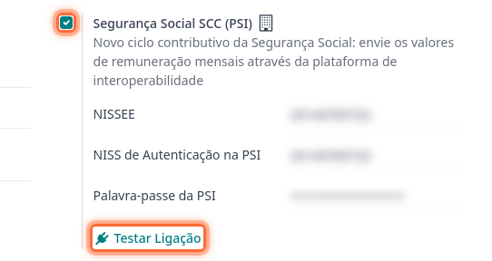

Declaração mensal
=================

Criar e enviar a declaração
---------------------------
Vá ao menu :menuselection:`Relatórios --> Portugal --> Segurança Social SCC --> Declarações SCC`.

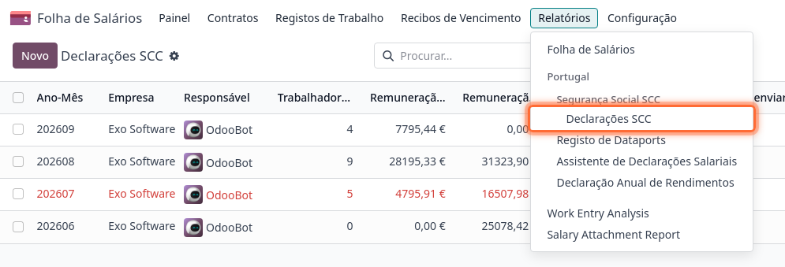

A lista mostra uma declaração por mês, com os valores declarados e apurados, a data limite de
confirmação, o estado e a situação do pagamento. Os meses que precisam de atenção, porque têm
divergências, estão por reenviar ou a confirmação foi recusada, aparecem a vermelho.

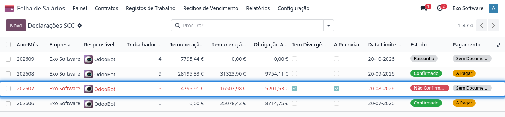

Carregue em **Novo**, escolha o **Ano-Mês** e carregue em **Calcular**. O Odoo junta os valores
dos recibos de vencimento desse mês, um registo por trabalhador e natureza de remuneração. As
faltas reduzem os dias e a remuneração base do mês. Um trabalhador que esteve ausente o mês todo,
por exemplo de baixa, é declarado sem dias e com valor zero: se não fosse declarado, a Segurança
Social apurava o mês com a remuneração permanente que tem registada. O **Responsável** da
declaração, por omissão quem a criou, é quem recebe os lembretes e avisos dessa declaração.

O botão **Linhas da Declaração** abre os registos da declaração numa lista própria, onde os pode
filtrar, agrupar e exportar.

Reveja os valores e carregue em **Enviar à Segurança Social**.

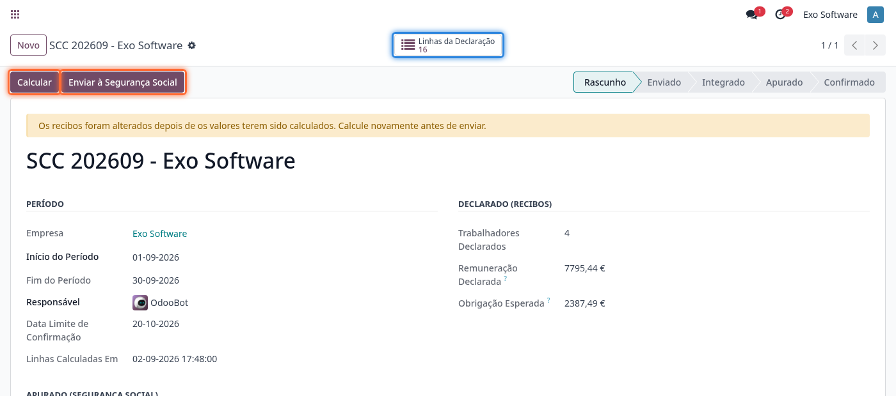

Antes de enviar, o Odoo confirma que a Segurança Social tem os contratos dos recibos do mês como
estão no Odoo. Os trabalhadores que não foram consultados na Segurança Social no último dia são
consultados nesse momento. Se faltar comunicar algum contrato, nada é enviado e a mensagem indica
os funcionários a resolver primeiro (veja `Comunicações do trabalhador`_). Os membros de órgãos
estatutários não têm contrato na Segurança Social e não entram nesta verificação.

Uma remuneração permanente por comunicar não impede o envio. Como a Segurança Social apura o mês
a partir das remunerações permanentes que tem registadas, a declaração mostra um aviso com os
funcionários que têm remunerações novas por comunicar.

A declaração passa pelos estados **Enviado** e **Integrado** à medida que a Segurança Social a
processa. Os alertas que a Segurança Social devolver ficam junto de cada registo, no separador
**Valores Declarados**. Use **Atualizar Estado** para os consultar de imediato, sem esperar pela
sincronização diária.

.. tip::
    Enquanto o mês não for confirmado, pode corrigir os recibos, calcular e enviar de novo a
    declaração quantas vezes for preciso. Cada envio substitui o anterior na Segurança Social.

Valores de meses anteriores
---------------------------
Alguns valores são pagos num mês mas pertencem a outro, como as horas extra feitas num mês e pagas
no seguinte, ou uma falta de um mês anterior corrigida no recibo atual. Para a Segurança Social,
cada valor é declarado no mês a que pertence, e cada envio substitui os valores desse mês.

Por isso, quando os recibos de um mês trazem valores de um mês anterior, esse mês anterior fica
marcado **A Reenviar**, e o responsável recebe uma atividade a pedir o novo envio. Ao calcular de
novo esse mês, os valores dos recibos posteriores entram na coluna **Correções Meses Posteriores**,
prontos a enviar.

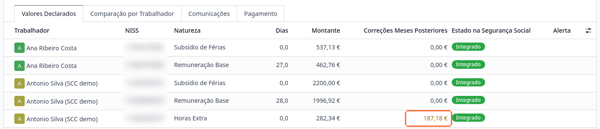

Comunicações
------------
O separador **Comunicações** guarda o histórico de cada envio: a data, o comprovativo de entrega,
o número de registos, o valor total e o estado. Abra uma comunicação para ver os valores
exatos que enviou e o estado e alerta que a Segurança Social atribuiu a cada um, mesmo depois de o
mês ter sido calculado e enviado de novo.

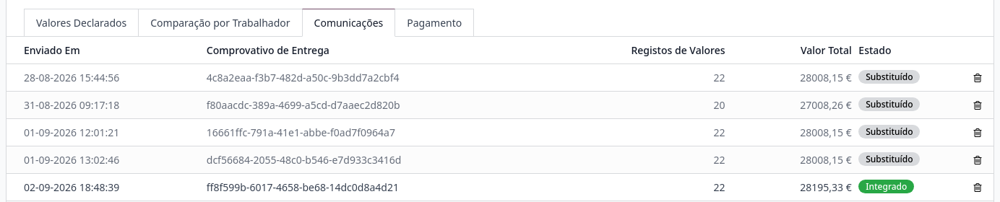

Confirmar o mês
===============
Terminado o mês, a Segurança Social faz o apuramento definitivo e a declaração passa a
**Apurado**. Até lá, os valores que devolve são provisórios. Depois de o mês terminar,
**Atualizar Estado** vai também buscar o apuramento. Se a Segurança Social ainda não apurou o mês,
o Odoo avisa.

Comparação por trabalhador
--------------------------
O separador **Comparação por Trabalhador** põe lado a lado, para cada trabalhador, os dias, o valor
e a obrigação contributiva declarados nos recibos e os apurados pela Segurança Social. Uma linha
com diferenças aparece a vermelho. Carregue em **Detalhe** para ver as remunerações e
contribuições que a Segurança Social apurou para esse trabalhador.

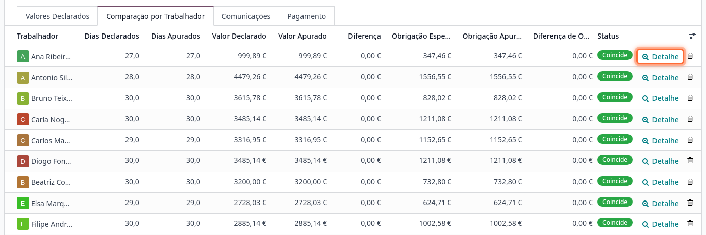

Se encontrar divergências, corrija os recibos e envie o mês de novo. Se os valores estiverem
certos, carregue em **Confirmar**. A Segurança Social devolve o resultado da confirmação, que fica
registado na declaração, e o comprovativo pode ser descarregado em **Comprovativo da
Confirmação**.

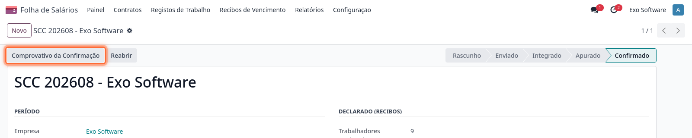

.. important::
    Se não confirmar nem comunicar valores diferentes até ao dia 20 do mês seguinte, a Segurança
    Social considera aceites os valores que apurou. Seis dias antes do prazo, o responsável da
    declaração recebe uma atividade a lembrar a confirmação.

Quando a Segurança Social recusa a confirmação, por exemplo porque o prazo já passou, a declaração
fica **Não Confirmado** com a resposta recebida, e pode ser confirmada de novo quando a situação
estiver resolvida.

Reabrir um mês confirmado
-------------------------
Enquanto a Segurança Social ainda aceitar novas comunicações para o mês, um gestor de salários pode
carregar em **Reabrir** para o corrigir e enviar de novo. A versão já confirmada mantém-se em vigor
até ser substituída por um novo envio confirmado.

Pagamento das contribuições
===========================
Com o mês apurado, o separador **Pagamento** permite pedir à Segurança Social o documento de
pagamento das contribuições da entidade empregadora. Carregue em **Pedir Documento de Pagamento**.
O documento emitido mostra o número, o valor a pagar, a validade e as referências de pagamento
(IBAN, entidade e referência Multibanco), prontas a copiar.

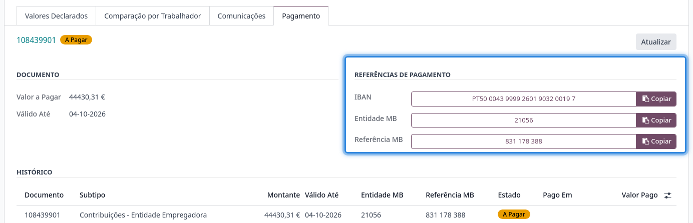

A Segurança Social emite o documento para tudo o que a empresa deve nesse momento, por isso um
pedido pode trazer mais do que um documento. Todos ficam no **Histórico**, cada um com o seu
estado:

- **Pago**, quando a Segurança Social comunica o pagamento nos seus comprovativos (verificado
  diariamente), ou quando o regista à mão com **Marcar como Pago**, se pagou antes disso
- **Expirado**, quando a validade termina sem pagamento. O responsável da declaração recebe uma
  atividade a pedir um novo documento, que pode pedir em **Pedir Novo Documento**

.. note::
    O pagamento não gera lançamentos contabilísticos: a reconciliação do extrato bancário continua
    a fazer-se como até aqui.

Comunicações do trabalhador
===========================
A admissão, as alterações de contrato, a cessação e as remunerações permanentes de cada
trabalhador também se comunicam à Segurança Social a partir do Odoo, no separador **Comunicação
SS** do contrato do funcionário, em :menuselection:`Folha de Salários --> Contratos`.

Comece por carregar em **Consultar na SS**. As comunicações disponíveis seguem o que a Segurança
Social tem registado para o trabalhador, e até à primeira consulta só aparece este botão.

A consulta guarda duas tabelas, que o separador mostra: os **Contratos Registados na Segurança
Social** (datas, modalidade, remuneração base e motivo) e as **Remunerações Permanentes Registadas
na Segurança Social** (tipo, datas e valor), de todos os contratos do trabalhador. A partir delas,
o separador indica em dois campos o que já está comunicado:

- **Contrato Comunicado à SS**: a Segurança Social tem o contrato como está no Odoo, com o mesmo
  início e, num contrato a termo, o mesmo fim. É este campo que permite enviar a declaração mensal
- **Remunerações Comunicadas à SS**: as remunerações permanentes do contrato foram comunicadas a
  partir do Odoo, ou a Segurança Social já tem os mesmos valores, por exemplo porque foram
  comunicados na Segurança Social Direta

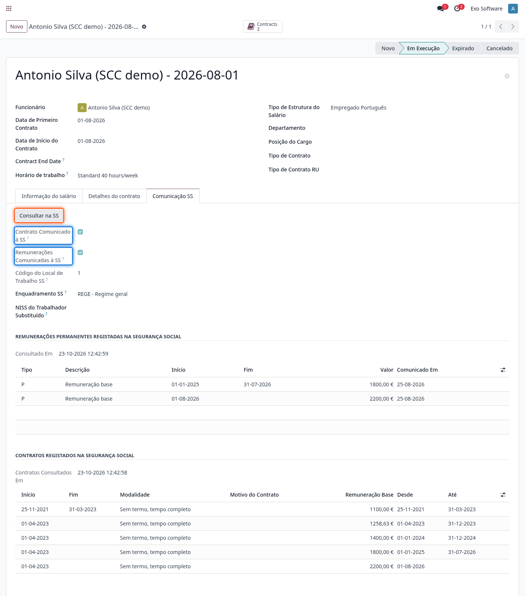

.. tip::
    Para consultar muitos trabalhadores de uma vez, selecione-os na lista de funcionários e use
    :menuselection:`Ação --> Consultar na SS`. Pode incluir funcionários arquivados: são
    consultados pelo seu último contrato. A Segurança Social responde por blocos de trabalhadores,
    e no fim o Odoo indica os que não foi possível consultar, por exemplo por não terem NISS
    válido.

Depois da consulta, o separador oferece apenas o que falta comunicar, pela ordem que a Segurança
Social aceita:

.. list-table::
   :header-rows: 1

   * - Botão
     - Quando aparece
   * - **Comunicar Vínculo**
     - A Segurança Social não tem nenhum vínculo aberto para o trabalhador: o primeiro contrato, ou
       um novo contrato a seguir a um que já terminou. Deve ser comunicado antes do início do
       contrato
   * - **Comunicar Alteração de Contrato**
     - A Segurança Social já tem um vínculo aberto e o contrato mudou, por exemplo na renovação de
       um contrato a termo, numa nova modalidade ou numa nova remuneração
   * - **Comunicar Remuneração Permanente**
     - O contrato alterou a remuneração base, o abono para falhas, as diuturnidades, a isenção de
       horário ou os duodécimos dos subsídios de férias e de Natal, e ainda não foi comunicado. Também
       aparece quando a consulta mostra que a Segurança Social tem outros valores, por exemplo um
       aumento que nunca lhe foi comunicado. Deve ser comunicado até ao dia 10 do mês seguinte à
       alteração
   * - **Comunicar Cessação**
     - O contrato que a Segurança Social tem registado terminou. O motivo de cessação da Segurança
       Social é proposto a partir do motivo de fim de contrato. Indique também se a comunicação é
       para efeitos de desemprego e, nalguns acordos de cessação, a justificação que a Segurança
       Social exige. Deve ser comunicada até ao dia 10 do mês seguinte

.. tip::
    Para atualizar as condições de um contrato, termine-o com o motivo **Por Atualização das
    Condições Contratuais** e crie o novo contrato a começar no dia seguinte. Para a Segurança
    Social, os dois são o mesmo contrato: a mudança comunica-se com **Comunicar Alteração de
    Contrato**, e não como um novo vínculo.

Quando um contrato altera uma destas remunerações e ainda não foi comunicado, o contrato mostra um
aviso. Antes de cada envio, o Odoo volta a consultar a Segurança Social: se a situação já não for a
esperada, não envia nada e diz o que falta comunicar.

.. note::
    Os membros de órgãos estatutários (MOE) não têm contrato de trabalho na Segurança Social. Para
    eles, o Odoo não oferece a comunicação do vínculo e comunica apenas as remunerações
    permanentes.

O **Código do Local de Trabalho SS** vem do código de estabelecimento do contacto do local de
trabalho do funcionário, o mesmo que é usado na DRI.

Histórico de comunicações
-------------------------
A Segurança Social não emite comprovativo destas comunicações. Por isso, cada comunicação aceite
fica registada com o que foi enviado, quem a enviou e quando. Abra o histórico no botão
**Comunicações SS** da ficha do funcionário.

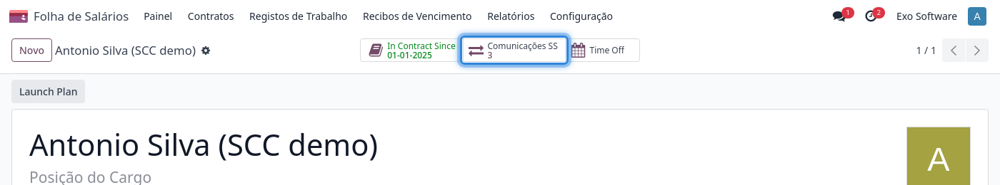

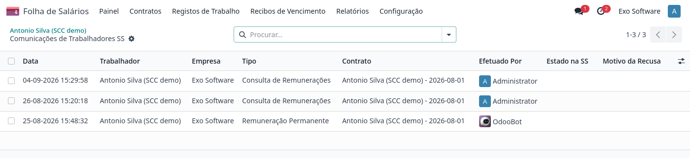

A Segurança Social aceita as comunicações de vínculo à entrada e só as processa depois. O estado de
cada uma, em processamento, integrada ou recusada com o motivo, é verificado diariamente. Uma
recusa é avisada a quem enviou a comunicação, e o contrato pode ser comunicado de novo.

Sincronização diária
====================
Todos os dias, o Odoo atualiza as declarações em curso: estado dos envios, valores apurados,
avisos da Segurança Social, pagamentos e lembretes de confirmação. Os avisos chegam ao responsável
de cada declaração como atividades.
